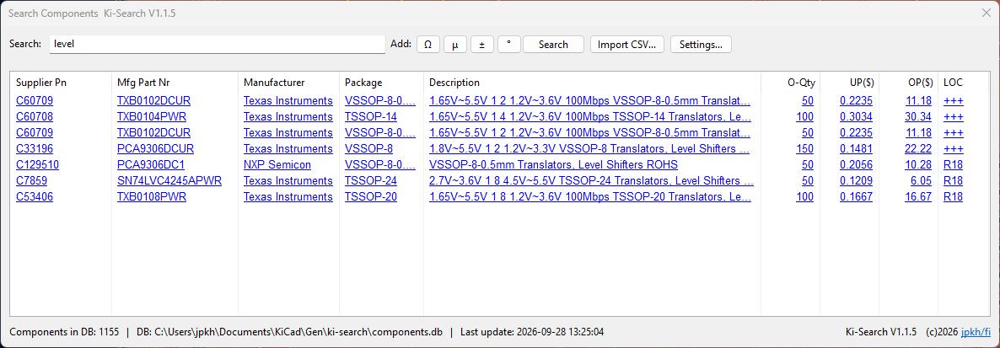

# KI-Search — Component Search for KiCad



A KiCad PCB-editor plugin that searches a local SQLite components database
directly inside pcbnew. Click a supplier part number in the results to open
its page on the supplier's site (LCSC or DigiKey).

## Features

- Full-text search across LCSC part number, manufacturer part number,
  manufacturer, package, description, order quantity and prices.
- Press **Enter** in the search box to search.
- Info line under the results: total components in the DB, database location,
  and date/time of the last import.
- Import supplier CSV files straight from the dialog (LCSC and DigiKey;
  Mouser planned). Multi-select up to 5 files; the supplier is
  auto-detected from the CSV header/file name, and a results dialog shows
  per-file lines processed, added, skipped and warnings. Imported files are
  archived in `cvsdone/` next to the DB.
- Results in a list with the supplier part number as a clickable link
  (opens the LCSC or DigiKey search page, matching the row's supplier).
- Optional row tooltip showing which CSV file a component came from
  (toggled in Settings).
- Settings dialog: choose which columns are visible and set a custom
  database path.
- Database lives outside the plugin package (your documents folder).
- Storage location (LOC column): shows a component's storage bin code
  (e.g. `R01`, `B02`, `BU3`), or `+++` when none is set. Right-click a
  result row and choose **Edit Location…** to pick a code from the static
  list, or clear it.

## Importing data

In the dialog choose **Import CSV…** and pick one or more CSV files
(max 5 per batch). The supplier format is auto-detected per file from the
CSV header (falling back to the file name); the supplier radio acts as a
fallback when nothing can be detected. Supported formats are the LCSC and
DigiKey order exports. After the import a results dialog shows, per file:
lines processed, rows added, rows skipped (with reasons), currency and
warnings. Rows without a supplier part number are skipped as a safety
measure.

Imported files are archived in a `cvsdone/` folder inside the active database
folder (created automatically). Every imported row remembers which file it
came from through an internal import number (not shown in the UI);
re-importing the same file — even renamed — is rejected. Prices keep their
currency: `€` in the price fields is treated as EUR, anything else as USD.

## Database

The plugin expects a SQLite database at:

```
<USER_DOCS>/KiCad/ki-search/components.db
```

with a table `components` containing the columns:

`lcsc_part_number`, `manufacture_part_number`, `manufacturer`, `package`,
`description`, `order_qty`, `unit_price`, `order_price`, `location`

## Installation

Via the KiCad Plugin and Content Manager (PCM): search for **KI-Search**, or
use **Install from File…** with a release zip from
[GitHub Releases](https://github.com/jpkh/ki_search/releases).

## Usage

Open a board in the PCB editor and click the KI-Search toolbar button, enter a
search term and press **Enter** (or click **Search**). Double-click a part
number to open it on the matching supplier's site (LCSC or DigiKey).
**Settings…** controls the visible columns and database path.

## Tools

`tools/processcvs-new.py` bulk-imports supplier CSV files into the database
from the command line (no KiCad needed). It imports oldest first, ordered by
the datecode in the file names, and archives processed files in `cvsdone/`:

```sh
python tools/processcvs-new.py -inDir C:\Temp\comp\cvs -outDir C:\Temp\comp
```

It can also repair missing prices from the CSV history
(`--dry-run` previews without changes):

```sh
python tools/processcvs-new.py -outDir C:\Temp\comp --rescan --dry-run
python tools/processcvs-new.py -outDir C:\Temp\comp --rescan
```

`tools/qrscan-add.py` assigns a storage location to components by scanning the
QR codes on LCSC bags (no KiCad needed). Point it at a location code, scan
away, type `exit` when done. It parses the `pc:`/`pm:` fields and matches the
part **by product code + order number + quantity** against the imports table,
so one bag equals exactly one database row — rows from other orders or with a
different quantity are never touched. Rows already at the target location are
skipped with a note; overwriting a different location asks for confirmation.
When no exact order/qty match exists (e.g. old bags whose QR order field
reads `GB…` instead of `WM…`), the candidate rows are listed and you pick the
matching one(s) by number (`1,3`) or `N` for none. A timestamped backup of
the database is made before the first write; `--dry-run` previews without
changing anything and `--yes` auto-selects every proposal:

```sh
python tools/qrscan-add.py R15 --db C:\Users\jpkh\Documents\KiCad\ki-search\components.db
python tools/qrscan-add.py R15 --dry-run --db C:\Users\jpkh\Documents\KiCad\ki-search\components.db
```

The database path defaults to `Documents/KiCad/ki-search/components.db`, the
same database the plugin uses, so `--db` can be omitted.

## License

GPL-3.0 — see [LICENSE](LICENSE). Copyright (c) 2026 Jani Hirvinen.
